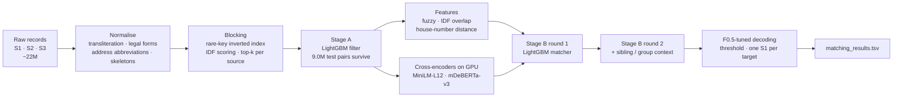

<div align="center">

# 🔗 Business Entity Resolution at Scale

**Amazon ML Challenge 2026 · Team *Out of Bounds***

Matching **1.7 million businesses** across three noisy data sources (~22M records, US · India · France)


</div>

> **Status: concluded.** Our team stopped at v4 (leaderboard F0.5 **0.97051**). This repository keeps the full
> pipeline, the trained models, the submission files and every experiment for reference.

---

## 📌 The problem

Each record in **Source 1** is a business (name + address + country). For every one of them, find
all records in **Source 2** and **Source 3** that describe the *same real-world business*, or
predict **no match**.

The data is messy in every way a real registry is:

| Source 1 | Source 2 / 3 | Why it's hard |
| --- | --- | --- |
| `Star Agro`, 708 6th B Cross, Koramangala, Bangalore | `Star Agro`, 352/708, Bangalore Urban, Krnaattk | different address formats, transliterated state |
| `All Technical`, 508 State St, Lovington | `All Tecchfntcal`, 508 State Street, Loington | typos in name *and* city |
| `Whalen Myers`, 523 Walnut St, Lockport | `Quosyn`, 523 Walnut Street, Lockport | same place, completely different name |
| `Nexus Trading`, Plot 31 MIDC, Taloja, Navi Mumbai | `NTrading`, Plot 31, Navi Mumbai | abbreviations |

**Metric:** macro-averaged **F0.5** per Source 1 entity (precision weighted 2× over recall).
An entity with no true match scores 1.0 only if we predict nothing, so singletons matter.

---

## 🏗️ Architecture



### 1 · Normalisation
Learned an **Indic-script → Latin transliteration dictionary** from aligned training pairs,
then normalised names (legal forms, honorifics, DBA/"formerly" aliases, websites) and addresses
(US/Indian/French abbreviations, states, city aliases, numbers). Every name token also gets a
**consonant skeleton** (`technical → tchncl`), which survives typos and transliteration variants.

### 2 · Blocking without an all-pairs scan
Comparing 1.7M × 10M records is impossible, so every record emits cheap **keys** (name tokens,
skeletons, skeleton pairs, concatenations, address words, number × word combinations), all
country-prefixed. Keys that occur too often in a target source are dropped as stop-keys. Candidates
are scored by the **sum of IDF weights of shared keys**, and only the top-k per source are kept.
Everything streams through disk in chunks, so memory stays bounded on a 16 GB laptop.

### 3 · Two-stage LightGBM matcher
* **Stage A** filters the candidate set cheaply (9.03M test pairs survive).
* **Stage B** scores the survivors with **69 features**: rapidfuzz similarities, IDF-weighted
  token overlap (a shared *rare* word is strong evidence, an unmatched rare word strong
  counter-evidence), numeric house-number distance, and ranks against competing candidates.
* **Round 2** adds *sibling* features: how a candidate compares with the other confident matches
  of the same entity (records of one business resemble each other).

### 4 · Multilingual cross-encoders (Kaggle 2× T4)
Two transformers were fine-tuned as pair classifiers on `[name | address] [SEP] [name | address]`:

| Model | Params | Result |
| --- | --- | --- |
| `paraphrase-multilingual-MiniLM-L12-v2` | 118M | 97.3% pair accuracy alone |
| `mdeberta-v3-base` | 280M | top-2 feature of the final model |

Their logits became features of the LightGBM matcher. The two models were trained on one half
of the training pairs and scored the other half, which prevents leakage.

### 5 · Decoding for F0.5
Thresholds are tuned directly on the exact macro-F0.5 metric on held-out entities, with a
one-Source-1-per-target constraint.

---

## 📈 Results

| Version | What changed | Validation F0.5 | Leaderboard F0.5 |
| --- | --- | :---: | :---: |
| v1 | blocking + 2-stage LightGBM (50 features) | 0.952 | 0.9405 |
| B1 | + rare-word IDF overlap, house-number distance | 0.9641 | — |
| C | + second-round sibling model | 0.9666 | — |
| **v4** | **+ MiniLM & mDeBERTa cross-encoder scores** | **0.9736** | **0.97051** |

Validation uses held-out *training entities*. After v1, it tracked the leaderboard within **0.3 pt**.

### 🔍 Where the remaining error is
The best score any matcher could reach on our candidate set is **0.981**, and v4 reaches
**99.2 %** of it. So the bottleneck is **candidate generation (recall)**, not the model.
A diagnostic of the missed true pairs showed why:

| Kind of missed pair | Share |
| --- | :---: |
| identical but generic names ("Star Agro", "Apex Tech") whose words are too common to be keys | 27 % |
| target record has an empty address | 27 % |
| same house number + street, different name | 30 % |

New exact-match keys (full name, name × city area, house number × street) plus a larger
candidate budget raise the ceiling from **0.9821 → 0.9883**
(see `code/business_entity_resolution/src/blocking.py`, `extra_keys=True`).

---

## 💡 Lessons learned

1. **Measure the ceiling first.** We computed the best possible score on our candidate set (0.981). That showed that
   after v4 a better matcher could add at most about 0.7 pt, while better candidate generation could add about 2 pt.
2. **A shared *rare* word beats any string-similarity score.** The IDF-weighted overlap features gave the largest
   single gain (+1.2 pt), more than any fuzzy-matching feature.
3. **Transformers work best as features.** Cross-encoder logits fed into LightGBM beat the cross-encoder on its own.
   Two different architectures (MiniLM + mDeBERTa) added value on top of each other.
4. **Engineer for the machine you have.** Chunked, streamed Polars jobs, one subprocess per chunk and one heavy job at
   a time let a 22M-record pipeline run on a 16 GB laptop. The GPU work went to free Kaggle notebooks.
5. **Build a validation set you trust.** Holding out whole entities, and scoring with the exact metric, kept our
   validation within 0.3 pt of the leaderboard, so every experiment could be judged offline.

## 🚀 If we continued

* Rebuild candidates with the new `extra_keys` and a top-40 budget. The measured ceiling rises 0.9821 → 0.9883,
  so the expected score is about 0.975–0.978.
* Query expansion: search the other source with an entity's confident matches. An oracle test recovers 23 % of the
  still-missed pairs for only about 7 extra candidates per entity.
* Embedding-based nearest-neighbour blocking (GPU) for typos and transliterations that share no key.
* Per-country thresholds (France is absent from training) and a separate "has any match" gate for singletons.

---

## 📂 Repository layout

```
.
├── code/business_entity_resolution/
│   ├── src/                 # pipeline (see table below)
│   ├── kaggle/              # MiniLM cross-encoder kernel
│   ├── kaggle_deberta/      # mDeBERTa-v3 cross-encoder kernel
│   └── requirements.txt
├── output_v4/               # submitted files (leaderboard 0.97051), Git LFS
├── artifacts/
│   ├── models/              # trained LightGBM round-1 / round-2 matchers
│   ├── ce_scores/           # cross-encoder scores for all train/test pairs
│   ├── test_final_ce_ce2.parquet  # v4 match probability for all 9.03M test pairs
│   ├── v1/                  # v1 package (zip) and v1 LightGBM models
│   └── logs/                # validation JSONs and run logs
├── submission/              # challenge package and documentation
└── progress_log.txt         # every experiment, with dates and scores
```

| `src/` file | Purpose |
| --- | --- |
| `run_prep.py`, `prep.py`, `normalize.py`, `translit.py` | transliteration dictionary + parallel normalisation |
| `blocking.py`, `candidates.py` | inverted-index blocking and candidate tables |
| `pipeline.py`, `predict.py` | v1: stage A/B training, tuning, chunked resumable inference |
| `features.py`, `features2.py` | pair features; IDF overlap, house numbers, sibling features |
| `build_survivors.py`, `export_kaggle.py` | stage-B feature tables; export pairs for the GPU kernels |
| `final_model.py` | v4: two-round matcher with cross-encoder features → submission |
| `train_matcher.py`, `analyze.py` | matcher ablations, error analysis |
| `eval_blocking.py`, `eval_blocking2.py`, `expansion_probe.py` | recall diagnostics |
| `data.py` | loaders and the exact macro-F0.5 metric |

---

## ▶️ Reproduce

```bash
cd code/business_entity_resolution
pip install -r requirements.txt           # Python 3.11; runs on 16 GB RAM, no GPU needed locally

# 1. normalise the challenge data (<DATA> = folder with train/ and test/)
python src/run_prep.py --data <DATA> --work work

# 2. blocking + stage A (+ v1 submission)
python src/pipeline.py --data <DATA> --work work --out output_v1

# 3. stage-B feature tables for train and test
python src/build_survivors.py --data <DATA> --work work --split train --n 600000
python src/build_survivors.py --data <DATA> --work work --split test

# 4. cross-encoders on a GPU (Kaggle): export pairs, run kaggle/ and kaggle_deberta/,
#    then copy ce_*.parquet and ce2_*.parquet into work/ce/
python src/export_kaggle.py --work work --out kaggle_data

# 5. final two-round matcher with both cross-encoders -> submission
python src/final_model.py --data <DATA> --work work --out output_v4 --ce ce ce2
```

End-to-end runtime is several hours on a 12-core laptop, plus about 3 GPU-hours on Kaggle for the two cross-encoders.
Seeds are fixed (42). The raw challenge data is not included in this repository.

---

## 👥 Team

**Out of Bounds**: Rishabh Agarwal (lead) · Hariom Ji Rai · Jatin

<div align="center"><sub>Built with Polars, LightGBM, rapidfuzz and 🤗 Transformers, on a 16 GB laptop and free Kaggle GPUs.</sub></div>
